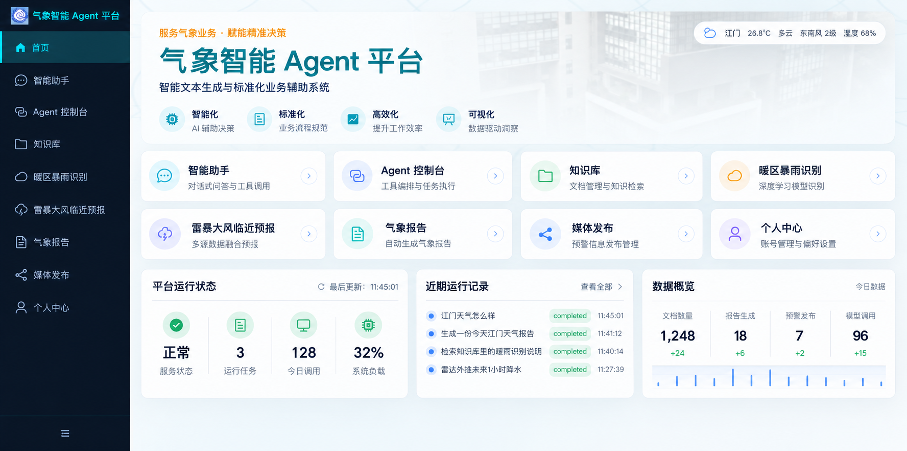
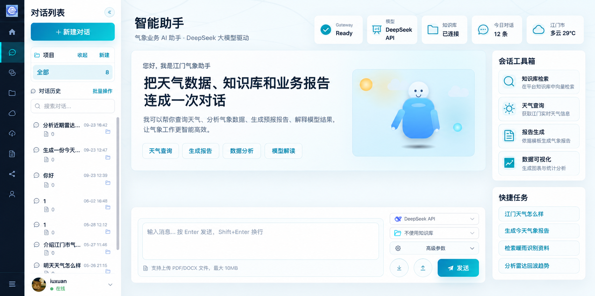
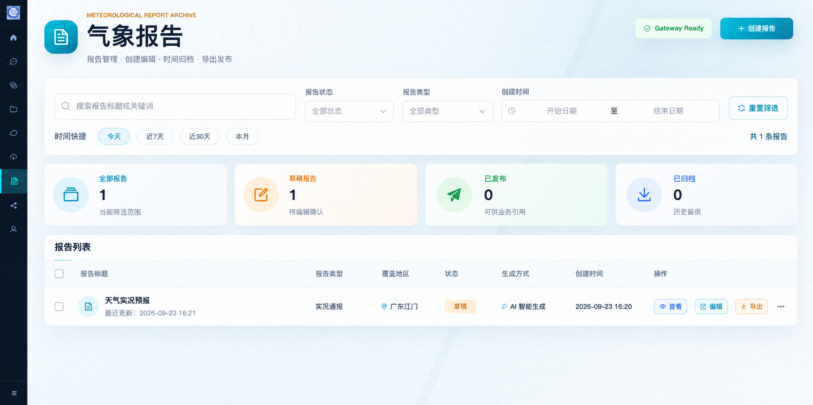
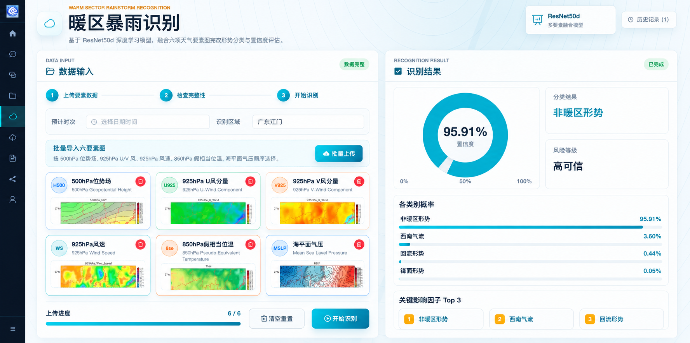
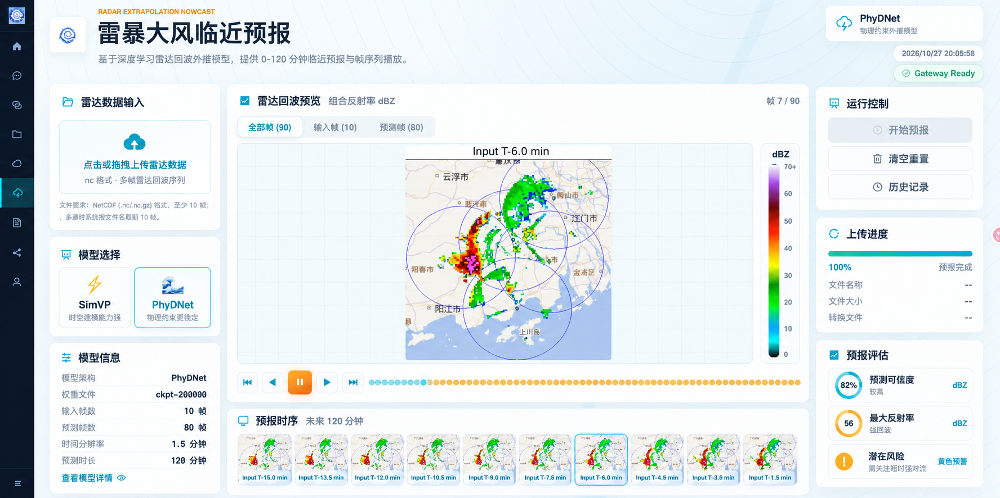

# 气象智能 Agent 平台

面向江门气象业务，提供**知识问答、标准报告生成、暖区暴雨形势识别与雷达回波外推**，为预报员提供辅助研判信息和业务材料。

`Python` · `ReAct` · `RAG` · `MCP` · `SSE` · `PostgreSQL / pgvector` · `Redis` · `Celery` · `MinIO` · `Docker Compose`

> 项目展示仓库 · 界面效果与个人工作说明 · 业务代码不公开

[效果展示](#效果展示) · [个人工作](#个人工作) · [项目成果](#项目成果) · [数字人项目](https://github.com/iuxuan/weather-digital-human-showcase)

## 效果展示

### 平台首页

统一查看知识问答、预报模型与报告入口。截图中的统计计数为历史界面内容；知识库规模以本页项目成果为准。

### 智能问答

面向气象业务资料查询，结合知识检索与工具调用辅助回答，展示执行过程。

### 标准报告

将标准气象报告的生成、查看、编辑和导出集中到同一业务页面，减少重复整理材料的操作。

### 暖区暴雨形势识别

展示形势识别结果，为预报员提供辅助判别依据。图中单次置信度不等于整体准确率或未来暴雨概率。

### 雷达回波外推

展示预测任务与回波变化。此历史界面配置为80帧、120分钟；最新简历披露的能力为10帧输入、120帧外推、1.5分钟/帧，最长3小时。截图沿用“雷暴大风临近预报”页面名称，此处展示的是雷达回波外推，不据此声明地面阵风预测能力。

## 个人工作

- **Agent与后端：**设计ReAct执行循环、参数校验、工具白名单与缺参追问，设置3轮决策预算及超时终止，使用SSE展示工具调用过程。
- **知识库检索：**文档解析与分块、Embedding、向量与BM25双路召回、RRF融合及Rerank重排，完成检索评测。
- **文档接入：**基于内容哈希、文档sha256与阶段化状态实现增量更新、断点续跑和幂等入库，减少重复向量化。
- **数据与模型：**承担气象数据清洗、样本处理、数据集划分、模型训练评估与服务接入。
- **任务与部署：**将暖区识别、雷达外推封装为MCP工具；使用Redis缓存检索结果，Celery执行文档入库与雷达推理，MinIO管理产物，Docker Compose部署联调。

## 项目成果

| 内容 | 简历披露结果 |
| --- | --- |
| 知识库 | 600余份业务文档，约2.4万知识片段 |
| 检索评测 | 100条人工标注测试题，片段级Recall@5由纯向量的73%提升至重排后的91% |
| 暖区识别 | 处理10年华南前汛期逐小时数据，训练ResNet50d双层分类头；2024、2025年所检验暖区暴雨过程命中率100% |
| 雷达外推 | 处理5年江门雷达观测数据，训练并接入两个时空预测模型；输入10帧、外推120帧，1.5分钟/帧 |
| 雷达检验 | 前30分钟准确率83.42%，沿用简历指标名称 |

暖区过程命中率不等于分类准确率或零虚警；简历未披露过程数、虚警率及雷达指标计算公式，本仓库不另补数字，也不将雷达准确率换称为CSI。

[简历条目对照](docs/resume-alignment.md) · [素材说明](docs/disclosure.md)

## 展示范围

本仓库由项目参与者禤俊延整理，用于展示个人参与的业务开发与项目成果。因合作协议及知识产权约束，仅公开项目介绍与界面效果图，不公开业务源代码、模型权重、原始业务数据、参考音视频、凭据及部署地址。

项目数据与耗时依据2026-10-27版本个人简历，截图用于展示功能，不作为本仓库独立复现的性能证据。相关代码与素材的权利归各权利人所有，详见[使用说明](NOTICE.md)。
